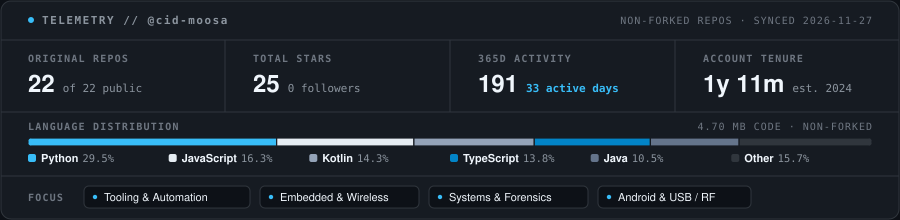

<picture>
  <source media="(prefers-color-scheme: dark)" srcset="./assets/hero-dark.svg" />
  <source media="(prefers-color-scheme: light)" srcset="./assets/hero-light.svg" />
  
</picture>

Systems and digital forensics developer building 64-bit acquisition engines, Linux system tools, Android USB/RF interfaces, and ESP32-S3 firmware.

[GitHub](https://github.com/cid-moosa) · [Email](mailto:arun.p.s2022@protonmail.com)

## Selected Work

| Project | Stack | Summary |
| :--- | :--- | :--- |
| [prodiscover](https://github.com/cid-moosa/prodiscover) | `Go` `Python` | 64-bit digital forensics suite combining a Go RAM/disk acquisition, MFT parser, and carver engine with a Tkinter GUI. |
| [ir-blaster](https://github.com/cid-moosa/ir-blaster) | `Kotlin` `Compose` | Native Android USB-C OTG IR transceiver supporting raw bulk endpoints, waveform visualization, and 100+ device profiles. |
| [grub-forge](https://github.com/cid-moosa/grub-forge) | `Python` `PyQt6` | Non-destructive Linux GRUB2 workstation with Btrfs/XFS discovery, Polkit separation, rescue scripts, and QEMU boot preview. |
| [esp32s3-nrf24-controller](https://github.com/cid-moosa/esp32s3-nrf24-controller) | `C++` `PlatformIO` | ESP32-S3-N16R8 firmware driving single or dual nRF24L01 radios over independent SPI buses with auto-probing and hardware triggers. |
| [labforge](https://github.com/cid-moosa/labforge) | `Python` `OOXML` | Automated `.docx` layout engine and agent skill resolving Word list/indent bugs, aligning screenshots, and compiling LibreOffice PDFs. |

<picture>
  <source media="(prefers-color-scheme: dark)" srcset="./assets/metrics-dark.svg" />
  <source media="(prefers-color-scheme: light)" srcset="./assets/metrics-light.svg" />
  
</picture>

<picture>
  <source media="(prefers-color-scheme: dark)" srcset="https://raw.githubusercontent.com/cid-moosa/cid-moosa/output/github-contribution-grid-snake-dark.svg" />
  <source media="(prefers-color-scheme: light)" srcset="https://raw.githubusercontent.com/cid-moosa/cid-moosa/output/github-contribution-grid-snake.svg" />
  
</picture>
