<div align="center">

# `cidmoosa`

**Systems • Hardware Forensics • Wireless Protocols • Reverse Engineering**

`arun.p.s` • `cyber forensics undergrad` • `silicon & packet level`

[GitHub](https://github.com/cid-moosa) • [Discord](https://discord.gg/cidm00sa) • [ProtonMail](mailto:arun.p.s2022@protonmail.com)

</div>

---

### ⚡ Telemetry & Contribution Progress

<div align="center">
  
</div>

<br/>

<div align="center">
  <picture>
    <source media="(prefers-color-scheme: dark)" srcset="./assets/github-contribution-grid-snake-dark.svg">
    <source media="(prefers-color-scheme: light)" srcset="./assets/github-contribution-grid-snake.svg">
    
  </picture>
</div>

<br/>

<div align="center">
  
</div>

<br/>

<div align="center">
  
  
</div>

---

### 🔬 Core Operations & Research

- **[snorty](https://github.com/cid-moosa/snorty-android)** — 802.11 wardrive reconnaissance companion paired with ESP32 promiscuous mode probe agent `Kotlin` `ESP32 C++`
- **[ir-blaster](https://github.com/cid-moosa/ir-blaster)** — USB Type-C OTG signal decoder & raw hex pulse learner for consumer IR dongles `Kotlin` `USB OTG`
- **[BharatTrace-AI](https://github.com/cid-moosa/bharattrace-ai)** — Autonomous forensic OSINT engine with recursive entity resolution across national databases `Go` `Forensics`
- **[KALI-FOX](https://github.com/cid-moosa/KALI-FOX)** / **[PIPY-FOX](https://github.com/cid-moosa/PIPY-FOX)** — Kernel compile suite for RTL8188EUS wireless chips w/ monitor mode & packet injection `C` `Linux Kernel`
- **[wakitaki](https://github.com/cid-moosa/wakitaki)** — Serverless offline-first P2P encrypted mesh voice transceiver `Android` `P2P`
- **[esp32-flasher](https://github.com/cid-moosa/esp32-flasher)** — ROM extraction, firmware flashing utility, and real-time UART telemetry console `Python` `Embedded`

---

### 🛠️ Arsenal & Toolchain

```yaml
hardware & rf      : ESP32, RTL-SDR, Logic Analyzers, USB OTG, Bus Pirate, UART, 802.11 Promiscuous
forensics & memory : Volatility, Wireshark, Ghidra, Serial/Flash Dumping, Linux Kernel Modules
languages & core   : C, C++, Python, Kotlin, Go, Bash Scripting, Linux Internals, Assembly (x86/ARM)
```

<div align="center">
  
</div>

---

<div align="center">

`cidmoosa` • `PGP / ProtonMail: arun.p.s2022@protonmail.com` • `Discord: @cidm00sa`

<br/>


</div>
